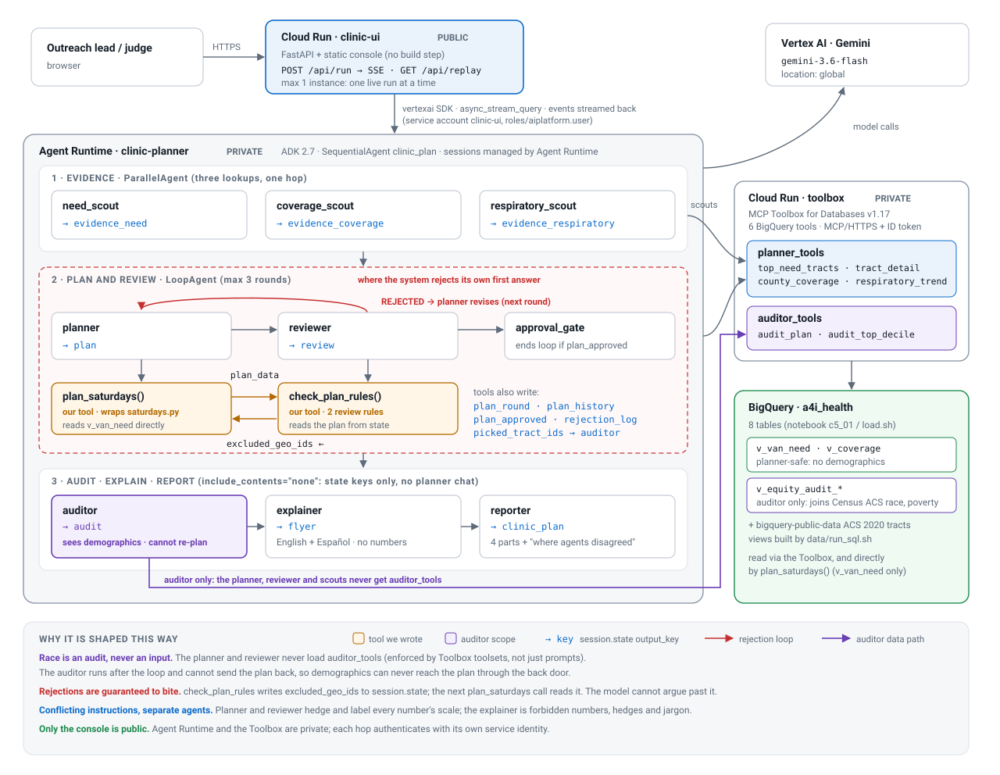
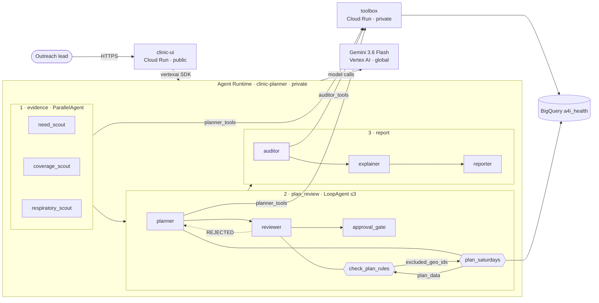

# Architecture: Clinic Plan

One county, one mobile clinic, four Saturdays. The system decides where the van parks and audits who the plan lands on. It also writes the flyer for each neighborhood.



- **Files:** [`architecture.svg`](architecture.svg) is the source; [`architecture.png`](architecture.png) is a 2560×1984 export for slides.
- **To re-export the PNG after editing the SVG:**

```bash
"/Applications/Google Chrome.app/Contents/MacOS/Google Chrome" --headless=new --hide-scrollbars \
  --force-device-scale-factor=2 --window-size=1280,992 \
  --screenshot="$PWD/docs/architecture.png" "file://$PWD/docs/architecture.svg"
```

## Components

| Piece | Where it runs | Access | Source |
|---|---|---|---|
| Console (UI + FastAPI) | Cloud Run `clinic-ui` | **Public** | [`frontend/`](../frontend) |
| 9 ADK agents | Agent Runtime `clinic-planner` | Private | [`agent/clinic_planner/`](../agent/clinic_planner) |
| MCP Toolbox for Databases | Cloud Run `toolbox` | Private: `run.invoker` for the agent identity only | [`agent/toolbox/tools.yaml.tmpl`](../agent/toolbox/tools.yaml.tmpl) |
| Gemini `gemini-3.6-flash` | Vertex AI, `global` | Google-managed | — |
| Tables and views | BigQuery `a4i_health` | Private | [`data/sql/`](../data/sql), [`notebooks/c5_01_load_explore.ipynb`](../notebooks/c5_01_load_explore.ipynb) |

## The agents

| # | Agent | ADK type | Reads (state) | Uses | Writes (state) |
|---|---|---|---|---|---|
| 1 | `need_scout`, `coverage_scout`, `respiratory_scout` | 3 × LlmAgent in a ParallelAgent | — | Toolbox `planner_tools` | `evidence_need`, `evidence_coverage`, `evidence_respiratory` |
| 2 | `planner` | LlmAgent in a LoopAgent (≤3 rounds) | `evidence_need`, `evidence_coverage`, `review` | **`plan_saturdays()`**, `planner_tools` | `plan` (+ the tool writes `plan_data`, `plan_history`, `picked_tract_ids`, `plan_round`) |
| 2 | `reviewer` | LlmAgent | `plan` | **`check_plan_rules()`** | `review` (+ the tool writes `plan_approved`, `excluded_geo_ids`, `rejection_log`) |
| 2 | `approval_gate` | custom BaseAgent | `plan_approved` | — | ends the loop (escalate) |
| 3 | `auditor` | LlmAgent, `include_contents="none"` | `picked_tract_ids`, `plan_approved` | Toolbox **`auditor_tools` only** | `audit` |
| 3 | `explainer` | LlmAgent, `include_contents="none"` | `plan` | — | `flyer` (English + Español) |
| 3 | `reporter` | LlmAgent, `include_contents="none"` | everything above | — | `clinic_plan` |

**Bold** marks the tools we wrote ourselves.

## Request flow

```mermaid
sequenceDiagram
    autonumber
    actor U as Outreach lead
    participant UI as clinic-ui (Cloud Run)
    participant AR as Agent Runtime
    participant TB as toolbox (Cloud Run)
    participant BQ as BigQuery
    U->>UI: Plan next month
    UI->>AR: async_stream_query (SSE back to the browser)
    par evidence
        AR->>TB: top_need_tracts / county_coverage / respiratory_trend
        TB->>BQ: v_van_need · v_coverage · disease_weekly
    end
    loop plan_review, up to 3 rounds
        AR->>BQ: plan_saturdays() reads v_van_need
        Note over AR: check_plan_rules(): round 1 REJECTED<br/>(missing data; tie broken by population)<br/>excluded_geo_ids written to state
    end
    AR->>TB: audit_plan(picked_tract_ids) · audit_top_decile
    TB->>BQ: v_equity_audit_* (Census ACS)
    Note over AR: explainer writes flyers · reporter assembles the Clinic Plan
    AR-->>UI: every event + final session.state
    UI-->>U: map, calendar, disagreement, audit, flyers
```

## Editable overview (Mermaid)



## Why it is shaped this way

1. **Race is an audit, never an input.**
   - The planner, reviewer and scouts never load `auditor_tools`. This is enforced by Toolbox toolsets, not only by prompts.
   - The auditor runs **after** the loop and can't send the plan back. If audit findings could trigger a re-plan, demographics would become a siting input through the back door.
2. **Rejections are guaranteed to bite.**
   - `check_plan_rules()` writes `excluded_geo_ids` to `session.state`, and the next `plan_saturdays()` call reads it. The model can't talk its way past a rejection.
   - `rejection_log` records every rejection for the reporter and the console's "Where agents disagreed" tab.
3. **Conflicting instructions need separate agents.**
   - The planner and reviewer hedge and label the scale of every number.
   - The explainer is forbidden numbers, hedges and jargon, and writes in English and Spanish.
   - The auditor reports uncomfortable findings and is forbidden to suggest tracts.
4. **Isolation by state, not conversation.** The auditor, explainer and reporter run with `include_contents="none"`. They see only the state keys named in their instructions, never the planner's reasoning.
5. **Least privilege.**
   - Only the console is public.
   - Each hop authenticates as its own identity:
     - the `clinic-ui` service account calls Agent Runtime
     - the Agent Runtime service agent calls the Toolbox with an ID token
     - `toolbox-identity` reads BigQuery
6. **Every number keeps its scale.**

| Data | Scale |
|---|---|
| Uninsured and chronic disease | Tract, modeled |
| No vehicle | Tract, survey |
| Distances | Straight line to federal sites: an upper bound |
| Air quality | 12 km grid, excluded from the score |
| Respiratory trend | Four-county region, never a neighborhood claim |

## Deploy

| Step | Command |
|---|---|
| Load data | Run `notebooks/c5_01_load_explore.ipynb`, or `bash scripts/load.sh 13121` |
| Build views | `bash data/run_sql.sh` |
| Agent and Toolbox | `bash agent/deploy_agent_runtime.sh` (uses `agent/deploy_toolbox.sh`) |
| Console | `bash frontend/deploy_ui.sh` |
| Local development | `bash agent/run_local.sh` (adk web), or `uvicorn frontend.app:app --port 8080 --loop asyncio` |
